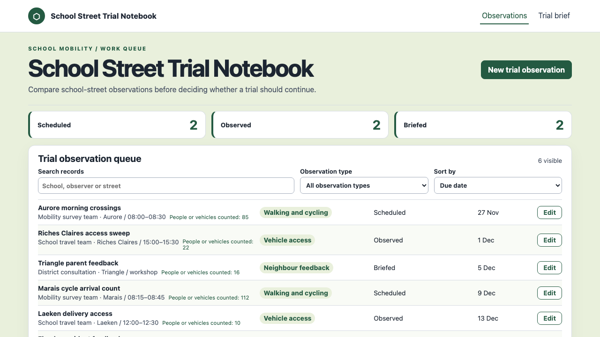
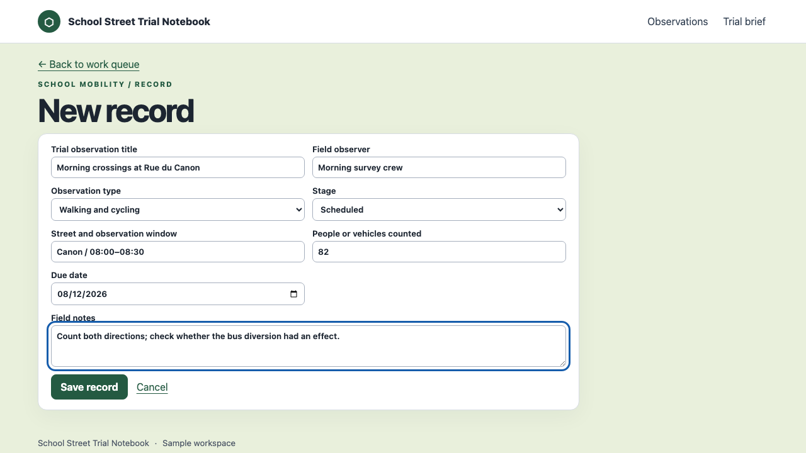

# School Street Trial Notebook

Compare school-street observations before deciding whether a trial should continue.

## Live demo

[Watch the recorded walkthrough](docs/demo.webm). Run both services below to try it yourself.

## Screenshots

## Main features

- Find records by title, owner, context or notes. Filter by observation type and sort by title or due date.
- Create and edit trial observation records with a deadline, notes and a checked number for people or vehicles counted.
- See stage counts and read the workflow playbook.

## Technology used

React, TypeScript, Spring Boot, JDBC and H2.

## Installation instructions

Use Node.js 24, Java 21 and Maven. From `backend/` run `mvn spring-boot:run`. From the project root run `npm ci` and `npm run dev`. Open the address printed by the frontend.

## Commercial licensing/contact

Contact [Amitesh2022](https://github.com/Amitesh2022) for commercial licensing.

## Business problem and users

Municipal mobility teams and school travel coordinators need a record of what they saw before and during a low-traffic trial. [Official background](https://www.brussels.be/reper-vreven-school-quarter).

## Key workflows

Search or filter the queue. Open a record, update its stage and save. Brief a result only once the observation window and a note on limitations are recorded.

## Framework highlights

React observation types use hooks for subscription lifetime and memoized filters and totals.

## Java backend highlights

Spring Boot separates API, service and JDBC repository code. It validates input, exposes a health endpoint and stores records in a local H2 file database. HTTP integration tests exercise search, create, edit and invalid requests.

## Architecture and state flow

The frontend requests `/api/records` through its development proxy. The Java service validates writes and returns the stored record. The frontend updates the queue from that response. The playbook and editor have separate hash URLs.

## Accessibility and responsive behaviour

The app uses labelled fields, visible keyboard focus, text stages and live save and error messages. Records and filters stack on smaller screens.

## Verification commands

- `npm test`, `npm run lint`, and `npm run build`.
- `cd backend && mvn verify`.

## Structure

- `src/`: frontend, view state and tests.
- `backend/`: Spring Boot service, database schema and tests.
- `docs/`: screenshots and walkthrough.

## Tradeoffs

This is a single-team sample workspace, not an official service. Records are fictional. H2 keeps local setup simple; the service is local-only and does not include sign-in, external delivery or production-level audit controls.

## Roadmap

Add team sign-in, change history, and import and export for reviewed records.
